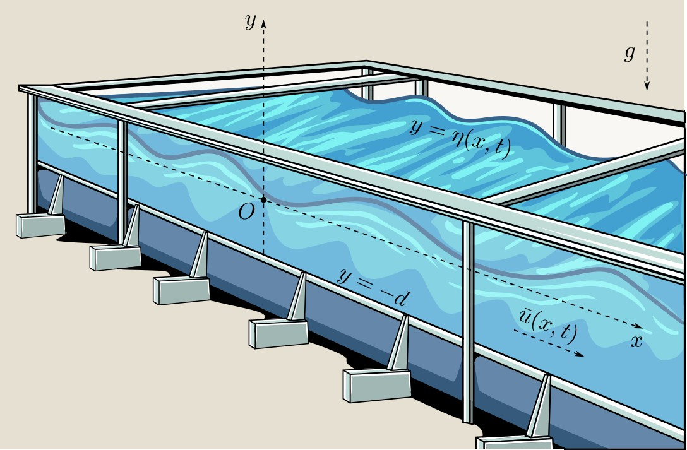
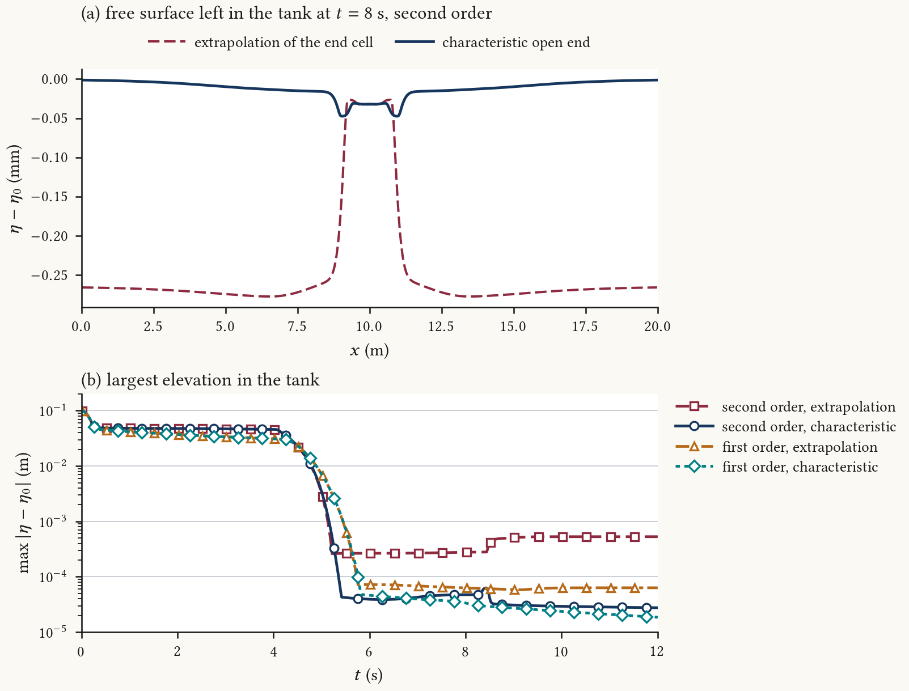

<!-- Author: Dr. Denys Dutykh (Mathematics Department, Khalifa University of Science and Technology, Abu Dhabi, UAE) -->

# 1DWaveTank: a numerical wave tank for the nonlinear shallow water equations, by finite volumes


The default experiment of the code (`sloping_beach`) at t = 6, 12, 18 and 25 s, computed with version 1.4.0 in GNU
Octave 11.1 as `run_simulation.m` computes it; version 1.5.0 gives the same frames, to the last bit. The tank is 40 m
long and 1 m deep at rest, with a beach of slope 0.1 over its last third and a wall at its right end; at the left end
the depth is driven as 1 + 0.2 sin(2πt/4) m. The first two sine waves have steepened into bores over the flat bottom
(a); the first one has run up the beach to about 0.2 m above the still-water level (b); the second bore climbs the slope
while the water of the first one runs back down (c); the run ends with three bores in the tank (d). The computation uses
1000 cells, the MUSCL reconstruction with the van Albada limiter, HLLE fluxes and the integrator `ode45` with tolerances
10⁻⁵, in place of the integrator `ode113` of MATLAB, which Octave lacks; it took 37 min in Octave, and takes about 26 s
in MATLAB with `ode113`. The former figure, computed in MATLAB with version 1.2.0, differs from this one by at most 6.4
mm at these four times, too little to be seen at this scale (see Version 1.4.0: what changed).

The MATLAB code 1DWaveTank solves the nonlinear shallow water (Saint-Venant) equations in one space dimension by
finite volume methods, over a variable bottom that may emerge from the water, with walls, wave-making,
open or periodic ends, and an optional bottom friction. It is a laboratory to compare schemes: each ingredient
(numerical flux, reconstruction, slope limiter, time integrator, boundary condition, initial condition, bottom,
friction law) is a function in its own package folder, chosen by a function handle in the configuration. No article
accompanies the code, so the software itself is cited (see How to cite).

## The problem

With the total depth H(x, t), the discharge HU(x, t) (U is the velocity averaged over the depth), the bottom elevation
z_b(x) and the free surface η = z_b + H, all elevations being counted upwards from the still-water level, the code
solves

```text
∂H/∂t  + ∂(HU)/∂x               = 0,
∂(HU)/∂t + ∂(HU² + g H²/2)/∂x    = − g H ∂z_b/∂x − g H S_f,
```

where g = 9.81 m/s² and S_f is the friction slope of the chosen law of bottom friction (none by default), the
dimensionless friction force on the bottom per unit weight of water. Over a wide channel, whose hydraulic radius is the
depth H, the three laws provided are

```text
Chézy            S_f = U|U| / (C² H)           C in m^(1/2)/s
Manning          S_f = n² U|U| / H^(4/3)       n in s/m^(1/3)
Darcy–Weisbach   S_f = f U|U| / (8 g H)        f dimensionless, constant or from the Colebrook–White formula
```

as written by Castro-Orgaz and Hager (Shallow Water Hydraulics, Springer 2019, Section 3.3.2, equations (3.10) and
(3.16), with the Chézy coefficient C = (8g/f)^(1/2)); the coefficient `phys.Cf`, applied when no law is given, is the n
of Manning's law. Every term of the momentum equation is in m²/s². In uniform flow down a bottom of slope S_0 the
friction slope equals the slope, S_f = S_0, which gives the normal velocity of each law for the depth H, for instance
U = H^(2/3) S_0^(1/2)/n with Manning's law. A cell whose depth is below the dry tolerance 10⁻⁶ m counts as dry.



The sketch above shows a tank in the notation of long-wave models (free surface y = η(x, t), flat bottom y = −d,
velocity ū averaged over the depth); the code uses a bottom z_b(x) of any shape, the total depth H and the discharge HU.

The tank is cut into N cells of width Δx, and the averages of H and HU over the cells obey a system of ordinary
differential equations: the differences of the numerical fluxes across the cell interfaces, given by an approximate
Riemann solver from the states on both sides, and a discrete bed slope. Two schemes are provided. The first-order
one, `core.rhs_nsw_1st_order`, uses the hydrostatic reconstruction of Audusse, Bouchut, Bristeau, Klein and
Perthame (2004, cited below): before the Riemann solver is called, the depths on both sides of the interface between
cells i and i + 1 are lowered to the higher of the two bottoms, and the bed slope enters the momentum equation of cell i
through these lowered depths (Φ is the momentum component of the numerical flux, z[i] the bottom of cell i):

```text
H_L[i+1/2] = max(0, H[i]   + z[i]   − max(z[i], z[i+1]))       (left state at the interface i + 1/2)
H_R[i+1/2] = max(0, H[i+1] + z[i+1] − max(z[i], z[i+1]))       (right state at the interface i + 1/2)

d(HU)[i]/dt = − (Φ[i+1/2] − Φ[i−1/2])/Δx + g/(2Δx) (H_L[i+1/2]² − H_R[i−1/2]²)
```

so that a lake at rest is an exact steady state over any bottom, at the ends of the tank as well (see below). The
second-order one, `core.rhs_nsw_2nd_order` (that of the default experiment), uses the second-order extension of the same
scheme (Section 3 of the same article, written in `core.hydrostatic_reconstruction_2nd_order`). The chosen
reconstruction (MUSCL with a slope limiter, for instance) gives the depth H and the free surface η = H + z at the two
edges of every cell, H_left[i] and η_left[i] at its left edge, H_right[i] and η_right[i] at its right edge, and the
bottom at each edge is their difference, z_left[i] = η_left[i] − H_left[i] and z_right[i] = η_right[i] − H_right[i]; the
discharge HU gives the velocity at the edges. The interface states and the bed slope are then

```text
z[i+1/2]   = max(z_right[i], z_left[i+1])
H_L[i+1/2] = max(0, η_right[i]  − z[i+1/2])
H_R[i+1/2] = max(0, η_left[i+1] − z[i+1/2])

d(HU)[i]/dt = − (Φ[i+1/2] − Φ[i−1/2])/Δx
              + g/(2Δx) (H_L[i+1/2]² − H_right[i]² + H_left[i]² − H_R[i−1/2]²)
              + g/(2Δx) (H_left[i] + H_right[i]) (z_left[i] − z_right[i])
```

The last term is the bed slope − g H ∂z/∂x of cell i, centred; the one before it is not zero only where the
reconstructed bottom jumps at an interface. At a lake at rest the free surface is flat at every edge of a wet cell, the
two states at each interface are equal, and the three terms cancel exactly: the scheme is well balanced, at a shoreline
too, and it is second-order accurate on smooth solutions (see A check of the schemes). Bottom friction comes from the
friction law `phys.friction_model`; when none is given, the friction coefficient `phys.Cf`, the n of Manning's law,
applies. The former names of the second-order right-hand side, `core.rhs_nsw_hybrid_order` and
`core.rhs_nsw_high_order`, call `core.rhs_nsw_2nd_order` (the second one without the coefficient `phys.Cf`, as before),
so that a configuration written for either runs unchanged, with the results of version 1.3.0 to the last bit unless its
tank has an open end, or it uses bottom friction or PVM fluxes (see Version 1.4.0: what changed and Version 1.5.0: what
changed). The system is then integrated in time either by a solver of MATLAB (`ode113`, `ode45`, ...) or by one of the
explicit schemes of the folder `+time`, whose step obeys the condition Δt = CFL Δx / max(|U| + √(gH)) or an estimate of
the local error.

At a solid wall, the ghost cells beyond the end of the tank hold the mirror image of the cells next to it: the depth
and the bottom are reflected as even functions about the wall, the discharge as an odd one. For a wall closing the tank
after its last cell N,

```text
H[N+k] = H[N+1−k],     HU[N+k] = − HU[N+1−k],     z[N+k] = z[N+1−k],     k = 1, 2, ...
```

Data reflected in this way stay symmetric under the shallow water equations, so that the velocity vanishes on the wall
(the argument of LeVeque, Finite Volume Methods for Hyperbolic Problems, Cambridge University Press 2002, Section 7.3.3,
with the bottom reflected like the depth). At the interface on the wall, the hydrostatic reconstruction then meets the
same bottom on both sides and the same depth H[N], so that no water crosses the wall and a lake at rest stays at rest
next to it, over any bottom. An open end lets waves leave the tank through the Riemann invariants U ± 2√(gH), constant
along the characteristics dx/dt = U ± √(gH) over a flat bottom (function `bc.open`). Its ghost cells keep the bottom
function beyond the end; the invariant that leaves the tank is taken from the end cell, its free surface carried over the
bottom of the ghost cell, and the invariant that enters it from the water at rest outside the tank, whose free surface
is the still-water level η0. For an open end after the cell N, with c = √(gH),

```text
H_x = max(0, η[N] − z[N+k]),        H_0 = max(0, η0 − z[N+k]),        z[N+k] = z_b(x[N+k]),

R+ = U[N] + 2 √(g H_x),             R− = − 2 √(g H_0),

U[N+k] = (R+ + R−)/2,      √(g H[N+k]) = (R+ − R−)/4,      HU[N+k] = H[N+k] U[N+k],      k = 1, 2, ...
```

and at an open end before the cell 1 the invariant R− leaves and R+ = 2 √(g H_0) enters. At rest (η[N] = η0, U = 0) the
ghost cells hold H_0, that is the free surface η0, and the lake stays at rest over any bottom; a wave reaching the end
leaves with its outgoing invariant while the incoming one stays that of still water, so that little of it is reflected.
Where the flow leaves faster than the waves, both invariants come from the end cell, and a dry end cell gives dry ghost
cells. The still-water level η0 is `bc.left.param.eta0` or `bc.right.param.eta0`; when the configuration does not give
it, `cfg.validate_config` takes the free surface of the end cell in the initial state. The ghost cells of a
wave-making end all hold the prescribed depth; they take the bottom of the end cell, as if the tank went on beyond its
end over a flat bottom, so that their free surface oscillates about the still-water level when the prescribed depth
oscillates about the depth of the end cell. In a periodic tank the ghost cells hold the periodic image of the bottom,
as of the state. In every case the free surface η = H + z of a ghost cell is that of the water it stands for, and a
lake at rest stays at rest at the end of the tank; the two right-hand sides give their ghost cells these bottoms
(function `bc.ghost_bathymetry`, which calls `bc.wall_bathymetry` at a wall).

## Quick start

In MATLAB, from the root folder of the repository:

```matlab
run_simulation
```

The script adds the repository to the path, builds the configuration of the experiment selected in
`+cfg/simulation_config.m` (by default `sloping_beach`), prints it, solves the equations with `core.solver`, animates
the free surface, the bottom and the velocity at every output time, and prints the CPU time (about 26 s for the default
experiment with version 1.2.0, with MATLAB R2025b on one core; the reconstruction of the free surface in version 1.3.0
makes each evaluation of the right-hand side about 23 % longer in GNU Octave). The solution stays in the workspace:
`results.t` holds the output times and `results.H`, `results.HU` and `results.U` one row per output time and one column
per cell, and `config` holds the configuration. With `config.save_results = true` in the configuration, both are also
saved to a file `output/results_<date>_<time>.mat`.

Another experiment is chosen by editing the line

```matlab
experiment_setup = 'sloping_beach'; % CHANGE THIS TO SELECT SETUP
```

near the top of `+cfg/simulation_config.m`; the parameters of each experiment are set in its own `case` of that file.
The user guide `UserGuide.md` describes the configuration fields and every component that can be chosen.

## Experiments

The nine experiments are the cases of `+cfg/simulation_config.m`; each case completes the defaults of
`+cfg/default_config.m` and the common settings written at the top of the file, which select a tank of 20 m with 500
cells, the first-order scheme with PVM fluxes and `ode113` with tolerances 10⁻⁴, up to t = 10 s. All nine run to their
final time. The last column reports a run of each in GNU Octave 11.1 (with `ode45` at the same tolerances where an
experiment asks for `ode113`, which Octave lacks) and, for the closed tanks, the largest change of the volume of water
V(t) = Σ H[i] Δx during the run, relative to its initial value.

| Experiment | Set-up | Run |
|---|---|---|
| `sloping_beach` | the default experiment, shown above | to 25 s; the free surface differs from that of version 1.2.0 by at most 9.4 mm, at the front of the first run-up, against 6.5 cm between the solutions on 500 and 1000 cells; the waves run up to 0.331 m above the still-water level, and the depth never falls below 5.6 × 10⁻⁷ m |
| `flat_wave_gen` | sine waves of amplitude 0.1 m and period 2π s made at the left end of a 20 m tank of depth 0.5 m, wall at the right end; MUSCL with the van Leer limiter, PVM fluxes, the second-order strong-stability-preserving Runge–Kutta scheme (SSP2) at CFL = 0.95 | to 10 s; the depth differs from that of version 1.4.0 by at most 3.9 × 10⁻⁵ m, through the dissipation that the PVM flux now adds where the free surface is nearly flat (see Version 1.5.0: what changed) |
| `flat_rest` | lake at rest 0.5 m deep over a flat bottom, walls at both ends; first order | to 10 s; the water stays at rest, the discharge exactly zero and the depth 0.5 m to 10⁻¹⁵; V constant to 2 × 10⁻¹⁶ |
| `gaussian_bump_rest` | lake at rest over a Gaussian bump of height 0.05 m, walls; second-order scheme with MUSCL and the van Leer limiter, HLLC fluxes, `ode113` with tolerances 10⁻⁹ | to 10 s, but the tank holds no water: `ic.lake_at_rest` puts the free surface at z = 0, the level of the bottom on which the bump stands, so that every cell has the dry depth 10⁻⁶ m, which now stays exactly in place |
| `flat_gaussian` | hump 0.1 exp(−2 (x − 10)²) m of the free surface, at rest on a depth of 0.5 m, open ends; MUSCL with the van Leer limiter, PVM fluxes, SSP2 at CFL = 0.95 | to 10 s; the two halves of the hump leave through the open ends, and V falls from 10.125 to 9.9998 m², the volume of the still water being 10 m² (to 9.9961 m² with the open end of version 1.3.0, whose reflections left the free surface up to 0.28 mm below the still-water level) |
| `flat_solitary` | solitary wave of amplitude 0.2 m on a depth of 0.5 m in the middle of the tank, walls; first order | to 10 s, the wave reaching the right wall at t = 3.3 s; V constant to 4 × 10⁻¹⁵ |
| `periodic_solitary` | the same wave in a periodic tank; first order | to 10 s; V constant to 2 × 10⁻¹⁵ |
| `dam_break` | breaking of a dam at x = 10 m between depths 0.8 m and 0.5 m, walls; first order, SSP2 at CFL = 0.95 | to 3 s; V constant to 4 × 10⁻¹⁵ |
| `dry_dam_break` | breaking of a dam at x = 10 m holding a depth of 0.5 m, dry bottom beyond it, walls; MUSCL with the van Leer limiter, asked in the Riemann invariants u ∓ 2√(gH) and done on the velocity (see Version 1.3.0: what changed), HLLE fluxes, forward Euler steps at CFL = 0.45 | to 1 s; V constant to 3 × 10⁻¹⁵, the depth never negative, the front (the last cell deeper than 1 mm) at x = 14.38 m where the exact solution of Ritter puts it at 10 + 2√(g × 0.5) = 14.43 m (14.10 m with version 1.2.0) |

The solitary wave is that of the Serre–Green–Naghdi equations (Carter and Cienfuegos, European Journal of Mechanics
B/Fluids 30, 2011, equation (9)); the shallow water equations, which have no dispersion, steepen it into a bore. Ritter's
solution of the dam break over a dry bottom is derived in Castro-Orgaz and Hager, Shallow Water Hydraulics, Springer
2019, Section 6.2: the front moves at the speed 2√(g h_L), h_L being the depth behind the dam.

Version 1.2.0 makes every experiment run. Four initial conditions, `ic.gaussian_bump`, `ic.solitary_wave`,
`ic.dam_break` and `ic.dry_dam_break`, took the cell centres as their first argument, while `core.solver` calls every
initial condition as `ic_handle(cfg)`; they now take `cfg` alone, as `ic.lake_at_rest` does, and read the cell centres
in `cfg.mesh.xc`. The experiments `flat_gaussian` and `periodic_solitary` read the field `config.param`, which the
common settings no longer define; they now set their still depth themselves (and `periodic_solitary` the amplitude of
its wave). The settings of `dry_dam_break` gave its MUSCL reconstruction neither a method nor an order, which
`cfg.validate_config` needs, and did not pass it to the high-order right-hand side, which would then have computed at
first order; both are set now, and its CFL number is 0.45 instead of 0.95, because forward Euler steps with a
second-order reconstruction keep the depth nonnegative under half the CFL bound of the first-order scheme (Audusse et
al. 2004, Section 3): at 0.95 the depth fell to −1.5 cm at the front. Four experiments, `flat_rest`, `flat_gaussian`,
`flat_solitary` and `periodic_solitary`, never set the ends of their mesh, which `cfg.validate_config` builds from
`mesh.domain`, and so were set in the 100 m tank of the defaults (where `flat_rest` ran) instead of the 20 m tank of
their names and initial conditions; they now copy the ends of the tank into `mesh.domain`. Finally, `flat_rest` sets its
flat bottom 0.5 m below the still-water level, so that its tank holds the 0.5 m of water of its name.

The solid wall of version 1.2.0 reflects the bottom as well (see The problem). The bottom of its ghost cells used to be
the bottom function evaluated beyond the wall, so that over a sloping bottom the two states of the hydrostatic
reconstruction at the wall differed in depth by about |dz/dx| Δx: a lake at rest was set in motion from the walls, and
water crossed them, at a rate that does not decrease with Δx. In a tank of 10 m closed by two walls over the bottom
z = −1 + 0.05 x, the first-order scheme gave the depth in the two cells next to the walls the time derivatives 0.078
and 0.055 m/s at rest, with 100, 200 or 400 cells alike; in 4000 steps of SSP2 at CFL = 0.5 (64 s, 100 cells), the
velocity reached 0.021 m/s and 2 % of the water left the tank. With the reflected bottom the velocity stays below
5 × 10⁻¹⁵ m/s and the volume does not change (A check of the schemes). Over a flat bottom the reflected and the former
ghost bottoms coincide, so that a wave reflected from a wall over a flat bottom is computed exactly as before, to the
last bit: `flat_wave_gen` is, and so is a hump of the free surface released between two walls over a flat bottom and
reflected back and forth for 20 s, by each of the three right-hand sides.

Version 1.1.1 corrected a misprint at line 84 of `+cfg/simulation_config.m`, where the common settings wrote the empty
reconstruction into the field `reconstructopenion` instead of `reconstruction`, the field that `cfg.validate_config`
reads. Through the misprint, the characteristic MUSCL reconstruction that `+cfg/default_config.m` defines as its default
reached every experiment that does not replace it whole: the configuration then announced a MUSCL reconstruction of
order 2 for experiments computed without one, and `gaussian_bump_rest` reconstructed in characteristic variables, which
its own settings do not ask for. The default experiment and `flat_wave_gen` gave the same solutions as before to the
last digit.

## Version 1.3.0: what changed

Version 1.3.0 makes the hybrid and high-order schemes well balanced, as the first-order one already was, by rebuilding
them on the free surface as Audusse et al. (2004, Section 3) do (see The problem). They used to reconstruct the depth H
and the discharge HU, and to lower the reconstructed depths with the bottoms of the cell centres (hybrid scheme) or to
put the mean of two bottoms on each interface (high-order scheme). Wherever the limiter flattens the reconstructed
depth, next to a wall over a slope s, at a kink of the bottom or at a shoreline, the two states at an interface then
differed by about s Δx/2 at rest, the depth changed at a rate near c s/4 with c = √(gH), whatever the cell width, and a
lake at rest was set in motion: in the tests of A check of the schemes its velocity reached 0.024 m/s over a slope,
0.069 m/s over a wavy bottom and 0.82 m/s at the shoreline of a beach.

Both schemes now reconstruct the depth and the free surface, take the bottom at the edges of each cell as their
difference, and apply the hydrostatic reconstruction and the bed slope of the article to these edge values. Of the three
quantities H, z and η = H + z, the article reconstructs H and η because this pair alone keeps both the lake at rest and
a nonnegative depth at a shoreline: a limited reconstruction of H is never negative, and a limited reconstruction of η is
flat in a wet cell at rest, even next to a dry one, where the free surface reconstructed in the dry cell lies at or above
that of the lake,

```text
η_left[i+1] = η[i+1] − φ(η[i+1] − η[i], η[i+2] − η[i+1])/2  ⩾  η[i]     when H[i+1] = 0 and η[i+1] > η[i],
```

since every limiter φ of `+reconstruct/+limiters` satisfies 0 ⩽ φ(a, b) ⩽ 2 min(a, b) when a and b are positive, and
φ(a, b) = 0 when a × b ⩽ 0. A reconstruction in the Riemann invariants u ∓ 2√(gH), which `dry_dam_break` asks for,
cannot serve here: in a lake at rest over a sloping bottom the invariants vary with the depth, their reconstruction is
not flat, and a depth taken from them does not match the reconstructed free surface. Where it is asked for, the
velocity U is reconstructed instead of the discharge, component by component like H and η; a limited velocity stays
between the velocities of the neighbouring cells at a wetting front, where the velocity HU/H of a reconstructed
discharge may grow without bound. A cell shallower than the dry tolerance has zero depth at its edges, so that the films
of 10⁻⁶ m that `ic.lake_at_rest` leaves on dry ground stay in place until water arrives. The two right-hand sides call
the same function, `core.hydrostatic_reconstruction_2nd_order`, and compute the same scheme.

The ghost cells of the high-order scheme at a wall now hold the mirror image of the bottom, as those of the two other
schemes have done since version 1.2.0. An open end used to copy the depth of the end cell into its ghost cells over the
bottom function beyond the end, and a wave-making end to put its prescribed depth over that bottom, so that over a
slope the free surface of the ghost cells differed from that of the tank and water flowed through the end from rest:
between two open ends over the slope z = −1 + 0.05 x, the depth of the end cells changed at rest at 0.078 m/s with the
first-order scheme and 0.039 m/s with the others, and every computation failed before t = 13 s; over the wavy bottom
87 % of the water left the tank in 74 s, and over the beach all of it. An open end now extends the free surface of
the end cell over the bottom function (see The problem), and a wave-making end puts its depth over the bottom of the
end cell (function `bc.ghost_bathymetry`, called by the three right-hand sides). Copying the bottom of the end cell
into the ghost cells of an open end would also keep the lake at rest, but over the wavy bottom it let round-off errors
grow into a current through the tank, by a factor e every 3 s from t = 80 s with the first-order scheme; with the
extended free surface the first-order scheme shows no such growth in 148 s (see A check of the schemes for the second
order). The first-order scheme is otherwise unchanged.

The experiments that use the first-order scheme (`flat_rest`, `flat_solitary`, `periodic_solitary`, `dam_break`) and
`flat_gaussian`, whose open ends stand on a flat bottom, give the same solutions as with version 1.2.0, to the last bit.
In the default experiment, version 1.2.0 already disturbed the lake at rest at the foot of the beach, where its free
surface fell by 0.83 mm within 0.2 s and stayed there, long before the first wave arrived; version 1.3.0 keeps the lake
ahead of the waves flat to 4 × 10⁻¹⁶ m. Over the whole run, computed in GNU Octave with `ode45` at the tolerances of the
experiment, the free surfaces of the two versions differ by at most 9.4 mm, at the front of the first run-up at
t = 12.6 s, and by 1.4 to 5.3 mm at t = 6, 12, 18 and 25 s, the mean difference of the depths staying below 0.2 mm;
the solutions of version 1.3.0 on 500 and 1000 cells differ by 2.7 to 6.5 cm, so that the change lies well within the
error of the scheme. The bores, the run-up to 0.331 m above the still-water level at t = 12.6 s and the volume of water,
33.0146 against 33.0142 m² at t = 25 s, are those of version 1.2.0. In `flat_wave_gen`, over a flat bottom, the depths
differ by at most 2.6 × 10⁻⁵ m, round-off differences that the PVM flux lets grow; `dry_dam_break` now puts the front of
the water at t = 1 s at x = 14.38 m, where the exact solution of Ritter puts it at 14.43 m (14.10 m with version 1.2.0);
and the films of `gaussian_bump_rest` stay in place exactly. The second reconstruction makes an evaluation of the
right-hand side of the default experiment about 23 % longer in GNU Octave.

## Version 1.4.0: what changed

Version 1.4.0 merges the two second-order right-hand sides under one name, makes all nine slope limiters run, gives the
open end a characteristic treatment, and redraws the figure at the top of this page with the new code.

The hybrid and high-order right-hand sides computed the same scheme since version 1.3.0, the hybrid one also applying
the friction coefficient `phys.Cf` when no friction law was given. They are now one function, `core.rhs_nsw_2nd_order`,
whose optional fourth argument says whether `phys.Cf` applies (it does by default), and the experiments name it. The
former names call it, `core.rhs_nsw_hybrid_order` with the coefficient and `core.rhs_nsw_high_order` without, so that
every configuration written for them runs unchanged. On 288 evaluations of the right-hand side (two bottoms; walls, open
ends, a wave maker and a periodic tank; two reconstructions; no friction, a friction law, or the coefficient alone;
three states away from rest), each former name gives with version 1.4.0 the same numbers as `core.rhs_nsw_2nd_order`
with the matching fourth argument, to the last bit, and the same numbers as with version 1.3.0 in the 216 evaluations
whose ends are walls, a wave maker or a periodic tank; at open ends the numbers change with the open end (below). The
nine experiments give the same solutions whether they name the new function or the former ones, to the last bit.

The limiters of Koren, OSPRE and Sweby read the tolerance `cfg.numerics.epsilon` without receiving the configuration,
so that the MUSCL reconstruction stopped at their first call. They now take the configuration as an optional third
argument, as the limiters of van Albada and UMIST did, and compute without dividing by a one-sided difference. The
formula of Sweby's limiter is now that of Sweby (High resolution schemes using flux limiters for hyperbolic conservation
laws, SIAM Journal on Numerical Analysis 21, 1984, equation (3.17)),

```text
φ(r) = max(0, min(β r, 1), min(r, β)),     1 ⩽ β ⩽ 2,     β = reconstruct.sweby_beta, 1.5 by default,
```

where the former formula, max(0, min(β r, β, r)), coincided with the minmod limiter for r ⩽ 1. The limiters minmod,
van Leer, superbee and MC accept the configuration as well, so that the MUSCL reconstruction calls every limiter of the
code with three arguments and no longer needs the function `contains` of MATLAB, which GNU Octave lacks, to retry with
two. All nine limiters now run; their results on a smooth flow and on a lake at rest are in A check of the schemes.

The open end used to extend the free surface and the discharge of the end cell into its ghost cells. It now takes the
Riemann invariant that leaves the tank from the end cell and the one that enters it from the still water outside, as
The problem describes. A lake at rest between two open ends then stays at rest over the slope, the wavy bottom and the
beach of A check of the schemes for ten minutes (600 s) with each of the nine limiters and with the first-order scheme,
its largest velocity staying below 4.5 × 10⁻¹⁴ m/s at the shoreline of the beach and below 7.5 × 10⁻¹⁵ m/s over the
slope and the wavy bottom, where with version 1.3.0 and the van Leer limiter it kept growing, tenfold in ten minutes,
to 2.8 × 10⁻¹³ and 3.1 × 10⁻¹³ m/s. A hump of the free surface 0.1 exp(−2 (x − 10)²) m at rest on a depth of 0.5 m,
leaving a tank of 20 m through its two open ends (500 cells, HLLE fluxes, SSP2 at CFL = 0.5), splits into two waves of
0.047 m. With the second-order scheme and the van Leer limiter, the extrapolation left behind them a depression of
0.26 mm all over the tank, 0.52 mm where the two reflected waves met, 1.1 % of the outgoing amplitude; the
characteristic end leaves the free surface within 0.063 mm of rest, 0.13 %, and with the van Albada limiter within
0.035 mm instead of 0.46 mm. With the first-order scheme, whose extrapolation reflected less, the residue falls from
0.068 to 0.040 mm. The experiment `flat_gaussian`, whose hump leaves through its open ends, gives the same solution as
with version 1.3.0, to the last bit, up to t = 2.7 s, before its waves reach the ends; afterwards its depths differ by
at most 0.28 mm, the size of the reflected depression, and after the waves have left its free surface stays within
0.042 mm of rest instead of 0.28 mm. The walls, the wave maker and the periodic tank are unchanged: the experiments
that use them give the same solutions as with version 1.3.0, to the last bit.

The figure at the top of this page is redrawn from a run of version 1.4.0 in GNU Octave 11.1, by the two scripts of
`docs/figures` that drew the former one from a run of version 1.2.0 in MATLAB, with `ode45` in place of `ode113`, which
Octave lacks, at the same tolerances 10⁻⁵. Its 126 frames are those of version 1.3.0 in GNU Octave, to the last
bit, and so are those of the same run under the name `core.rhs_nsw_high_order`, which the experiment used until
version 1.3.0. Over the whole run its free surface differs from that of the former figure by at most 13 mm, at the
front of a bore at t = 21.8 s, and by 0.9, 2.5, 5.3 and 6.4 mm at t = 6, 12, 18 and 25 s, the mean differences staying
below 0.2 mm: the change of version (at most 5.3 mm at these times, see Version 1.3.0: what changed) and the change of
integrator are too small to be seen at the scale of the figure. The volume of water at t = 25 s is 33.0142 m², against
33.0146 m² in the former run.

## Version 1.5.0: what changed

Version 1.5.0 corrects the laws of bottom friction, gives the PVM flux its own threshold of dissipation, adds to this
page a second figure, on the waves that leave the tank through its open ends, and silences a warning about the mesh that
the default experiment printed although nothing was wrong.

The friction laws returned the term − g S_f, in m/s², which the right-hand sides added to the time derivative of the
discharge HU, in m²/s²: the factor H of the term − g H S_f of the momentum equation was missing, and the law of
Darcy–Weisbach returned − g² S_f. Friction was therefore too strong by the factor 1/H, H in metres, with the laws of
Chézy and Manning and with the coefficient `phys.Cf`, right only in water 1 m deep, and by the factor g/H with the law
of Darcy–Weisbach; in the films of 10⁻⁶ m left on dry ground it was a million times too strong or more. Each law now
computes its friction slope S_f in the standard form given in The problem and returns − g H S_f, so that every term of
the momentum equation is in m²/s², and the coefficient `phys.Cf` is the n of Manning's law, as its formula already said.
In uniform flows down a slope, the velocity reached is now the normal velocity of each law to round-off, where version
1.4.0 reached √H times it with the laws of Chézy and Manning, and a supercritical flow fed at the top of a channel
settles to the normal depth of the law (A check of the schemes). A lake at rest with friction switched on stays at rest,
its velocity below 4.5 × 10⁻¹⁵ m/s over the slope, the wavy bottom and the beach of A check of the schemes, between
walls and between open ends, for the five laws (Chézy, Manning, Darcy–Weisbach with a constant factor and with the
factor of Colebrook–White, and the coefficient `phys.Cf`) and both schemes. With the friction corrected and nothing else
changed, the nine experiments, none of which uses friction, give the same solutions as with version 1.4.0, to the last
bit, and so do the 288 evaluations of the right-hand-side bank of Version 1.4.0: what changed that apply no friction.

The PVM flux added no dissipation where the states on the two sides of an interface differed by less than 10⁻⁶ in depth
and in discharge, its threshold being the dry tolerance, and was central there, so that round-off errors grew up to that
size: a lake at rest reached 10⁻⁶ m/s, and 1.9 × 10⁻⁵ m/s at the shoreline of the beach. Its threshold is now its own,
the field `pvm_tolerance` of the configuration, 0 by default, so that only identical states pass without viscosity, and
the same lakes stay at rest to 6.3 × 10⁻¹⁵ m/s, as with the other fluxes; a threshold of 10⁻¹⁴ would let them reach
8 × 10⁻¹³ m/s, and the threshold 10⁻⁶ gives back the drift of version 1.4.0, to the last bit. The experiments computed
with PVM fluxes over a moving free surface change by the dissipation that the flux now adds where the free surface is
nearly flat, ahead of the waves and at their crests: the depths of `flat_wave_gen` differ from those of version 1.4.0
by at most 3.9 × 10⁻⁵ m, those of `flat_solitary` and `periodic_solitary` by 5.0 × 10⁻⁵ and 4.7 × 10⁻⁵ m, those of
`flat_gaussian` by 7.3 × 10⁻⁶ m and those of `dam_break` by 4.1 × 10⁻⁷ m: a few ten-thousandths of the height of
their waves, and about a thousand times less than the difference between the solutions on 500 and 1000 cells (3.8 cm
for `flat_wave_gen`, 6.6 cm for `flat_solitary`). The experiment `flat_rest`, whose states are all equal, is
unchanged to the last bit, as are the experiments computed with other fluxes.

The second figure of this page, in A check of the schemes, shows a hump of the free surface leaving the tank through its
two open ends, with the open end of version 1.4.0 and with the extrapolation of the end cell that it replaced; two new
scripts of `docs/figures` draw it, as two others draw the first.

The default experiment printed a warning that its cell width, 0.04 m, did not match the tank of 100 m of the defaults
divided by its 1000 cells, although it gives its own cells, 0.04 m wide over 40 m, and the computation used them. The
validation of the configuration now compares the cell width with the spacing of the cell centres when the configuration
gives them, and then takes the ends of the tank from these cells; it warns only when the cell width does not match the
cells, given or built from the ends of the tank.

## A check of the schemes

A scheme is well balanced when a lake at rest (U = 0, and η = 0 wherever the bottom lies below the still-water level) is
an exact steady state of its discrete equations. Three bottoms were tried on 0 ⩽ x ⩽ 10 m, cut into 100 cells: the
slope z = −1 + 0.05 x, the wavy bottom z = −0.7 + 0.15 sin(2πx/7) + 0.02 x, and the beach z = −1 + 0.15 x, whose
shoreline lies 3.3 m before the right end; the tank was closed by walls at both ends, or open at both ends. The state
H = max(−z, 0), HU = 0 was advanced by 4000 steps of SSP2 at CFL = 0.5 (64 to 74 s), with HLLE fluxes and, for the
second-order scheme, the MUSCL reconstruction with the van Albada limiter of the default experiment. The table gives the
largest velocity in the wet cells during the run, in m/s, with versions 1.2.0 and 1.4.0 of the code (between open ends,
over the first 4000 steps of the runs of 600 s below); between walls, version 1.3.0 gives the same numbers as
version 1.4.0, to the last bit, and version 1.5.0 gives them at both kinds of ends.

| Bottom and ends | First order, 1.2.0 | First order, 1.4.0 | Hybrid and high order, 1.2.0 | Second order, 1.4.0 |
|---|---|---|---|---|
| slope, walls | 4.3 × 10⁻¹⁵ | 4.3 × 10⁻¹⁵ | 0.024 and 0.011 | 2.6 × 10⁻¹⁵ |
| wavy bottom, walls | 4.8 × 10⁻¹⁵ | 4.8 × 10⁻¹⁵ | 0.069 and 0.029 | 3.2 × 10⁻¹⁵ |
| beach, walls | 4.5 × 10⁻¹⁵ | 4.5 × 10⁻¹⁵ | 0.57 and 0.82 | 2.4 × 10⁻¹⁵ |
| slope, open ends | computation failed at t = 12.7 s | 4.4 × 10⁻¹⁵ | computation failed at t = 12.9 and 12.8 s | 3.5 × 10⁻¹⁵ |
| wavy bottom, open ends | 2.6, and 87 % of the water lost | 4.3 × 10⁻¹⁵ | 2.6 and 2.7, and 87 % of the water lost | 2.6 × 10⁻¹⁵ |
| beach, open ends | 3.4, and all the water lost | 4.5 × 10⁻¹⁵ | 3.4 and 4.9, and all the water lost | 4.5 × 10⁻¹⁵ |

With version 1.4.0 the time derivative of the depth is exactly zero at rest and that of the discharge below 1.3 × 10⁻¹⁴
m²/s², in every case and for both schemes; at the end of every run, of 64 to 74 s between walls and of 600 s between
open ends, the free surface lies within 1.3 × 10⁻¹⁵ m of rest and the volume of water has changed by less than 2 × 10⁻¹⁵
of its value. The second-order scheme keeps the lake at rest just as well with the fluxes HLL, HLLC, Rusanov, Roe, FVCF,
Lax–Friedrichs and central-upwind (below 2.4 × 10⁻¹⁴ m/s over the wavy bottom and the beach between walls), and the
other reconstructions of `+reconstruct` keep the beach between walls at rest over 200 steps, to 2.5 × 10⁻¹⁵ m/s with
ENO2, UNO2, PPM and MP5, and to 8 × 10⁻¹³ m/s with WENO5, whose reconstruction of a constant is exact only to round-off.
With version 1.2.0 the depth of the second-order schemes changed at rest at rates up to 0.039, 0.10 and 0.12 m/s over
the three bottoms, and the depth at an open end over a slope at 0.078 m/s with the first-order scheme. Over the bottom
of the default experiment, whose beach meets the flat bottom at a kink, the right-hand side of version 1.2.0 at rest
reached 0.060 m/s in the depth and 0.22 m²/s² in the discharge; that of version 1.4.0 gives 0 and 3 × 10⁻¹⁴ m²/s².

The nine slope limiters were each tried on the same lakes at rest, between walls for 64 s and between open ends for
600 s, and on the smooth flow described below. The table gives, for the second-order scheme with each limiter, the
largest velocity of the lake at rest over the three bottoms, in m/s, and the L1 error of the depth of the smooth flow on
800 cells, against the reference computed with the van Leer limiter on 3200 cells, with the observed order between 400
and 800 cells, measured against the reference and from the differences between successive meshes. The first-order
scheme keeps the lakes between open ends at rest for 600 s to 5.3 × 10⁻¹⁵ m/s.

| Limiter | Lake at rest, walls, 64 s | Lake at rest, open ends, 600 s | L1 error, N = 800 | Order, against the reference | Order, successive meshes |
|---|---|---|---|---|---|
| minmod | 7.6 × 10⁻¹⁵ | 1.4 × 10⁻¹⁴ | 1.3 × 10⁻⁵ | 1.90 | 1.75 |
| van Leer | 5.2 × 10⁻¹⁴ | 3.1 × 10⁻¹⁴ | 5.1 × 10⁻⁶ | 2.10 | 1.97 |
| van Albada | 3.2 × 10⁻¹⁵ | 4.6 × 10⁻¹⁵ | 7.8 × 10⁻⁶ | 1.88 | 1.97 |
| superbee | 4.6 × 10⁻¹⁴ | 3.7 × 10⁻¹⁴ | 1.3 × 10⁻⁵ | 1.93 | 1.54 |
| MC | 5.5 × 10⁻¹⁴ | 3.0 × 10⁻¹⁴ | 4.1 × 10⁻⁶ | 2.07 | 2.02 |
| Koren | 4.0 × 10⁻¹⁴ | 4.5 × 10⁻¹⁴ | 4.8 × 10⁻⁶ | 2.05 | 1.98 |
| UMIST | 8.3 × 10⁻¹⁵ | 1.1 × 10⁻¹⁴ | 7.1 × 10⁻⁶ | 1.98 | 1.85 |
| OSPRE | 1.7 × 10⁻¹⁴ | 2.4 × 10⁻¹⁴ | 5.6 × 10⁻⁶ | 2.11 | 1.97 |
| Sweby | 3.0 × 10⁻¹⁴ | 3.5 × 10⁻¹⁴ | 1.3 × 10⁻⁵ | 1.88 | 1.66 |

All nine limiters keep the lake at rest to round-off, at walls, at open ends and at the shoreline of the beach, and
converge on the smooth flow at an order close to 2. Minmod, the most dissipative, and the compressive limiters superbee
and Sweby (β = 1.5) make errors 2.3 to 3.3 times larger than van Leer, MC, Koren and OSPRE, and approach the order 2
more slowly.

No drift remains. With version 1.4.0 the PVM flux let the velocity of the lakes at rest of the first table reach
10⁻⁶ m/s, and at the shoreline of the beach with the second-order scheme 1.5 × 10⁻⁵ m/s between walls and
1.9 × 10⁻⁵ m/s between open ends, as it added no dissipation where the states on the two sides of an interface differed
by less than the dry tolerance 10⁻⁶; with the threshold of version 1.5.0 the same lakes stay below 6.3 × 10⁻¹⁵ m/s with
both schemes. Between two open ends, the extrapolation of version 1.3.0 let round-off errors grow with the van Leer
limiter: over the slope and the wavy bottom the largest velocity rose from 2.5 × 10⁻¹⁴ and 2.6 × 10⁻¹⁴ m/s in the first
minute to 2.8 × 10⁻¹³ and 3.1 × 10⁻¹³ m/s in the tenth, and was still growing at t = 600 s, by about 3 × 10⁻¹⁴ m/s a
minute; with the characteristic open end it stays below 6.7 × 10⁻¹⁵ m/s over the same ten minutes, without growth.



An open end must let a wave leave the tank without sending much of it back. In the figure above, a hump of the free
surface 0.1 exp(−2 (x − 10)²) m on water 0.5 m deep, in a tank of 20 m cut into 500 cells (HLLE fluxes, SSP2 at
CFL = 0.5), splits into two waves of 0.047 m that leave through the two open ends near t = 5 s. Look at what they leave
behind. With the extrapolation of the end cell, the open end of versions 1.3.0 and earlier, the free surface stays 0.25
to 0.28 mm below the still-water level η0 over most of the tank (a), and the largest elevation settles at 0.53 mm, 1.1 %
of the outgoing waves, once the two reflected depressions have met near t = 8.5 s (b); with the characteristic open end
of version 1.4.0 it falls to 0.063 mm, 0.13 %, and with the first-order scheme from 0.068 to 0.040 mm. The figure is
drawn by `docs/figures/open_end_reflection_data.m`, which computes the four runs in MATLAB or GNU Octave (the
extrapolation is what `bc.open` does when no still-water level is given), and `docs/figures/plot_open_end_reflection.py`.

Bottom friction was checked on uniform flows down an inclined channel. The bottom z = −S_0 x with S_0 = 0.001 is cut
into 20 cells of 5 m, and the ghost cells copy the end cells over the bottom continued beyond the ends, so that a uniform
flow stays uniform. Water of depth H starts from rest and accelerates down the slope until friction balances gravity,
g H S_0 = g H S_f: the second-order scheme (MUSCL with the van Albada limiter, HLLE fluxes, SSP2 at CFL = 0.5) computes
the bed slope of a uniform flow over a linear bottom exactly, so that it must reach the normal velocity of the law. The
table gives the normal velocity for H = 0.1, 0.5 and 2 m, the relative difference of the velocity reached with
version 1.5.0 after 40 relaxation times U/(2 g S_0), and the velocity reached with version 1.4.0.

| Law | Normal velocity for H = 0.1, 0.5 and 2 m (m/s) | Version 1.5.0, relative difference | Version 1.4.0 (m/s) |
|---|---|---|---|
| Chézy, C = 50 m^(1/2)/s | 0.500, 1.118, 2.236 | −5.0 × 10⁻¹⁴, −1.9 × 10⁻¹⁴, −1.9 × 10⁻¹⁴ | 0.158, 0.791, 3.162 |
| Manning, n = 0.03 s/m^(1/3), and `phys.Cf` = 0.03 | 0.227, 0.664, 1.673 | −5.0 × 10⁻¹⁴, −1.5 × 10⁻¹⁴, −2.8 × 10⁻¹⁵ | 0.0718, 0.470, 2.366 |
| Darcy–Weisbach, f = 0.03 | 0.511, 1.144, 2.287 | −5.0 × 10⁻¹⁴, −1.8 × 10⁻¹⁴, −2.0 × 10⁻¹⁴ | 0.0516, 0.258, 1.033 |
| Darcy–Weisbach with Colebrook–White, roughness 1 mm | 0.554, 1.525, 3.535 | −5.1 × 10⁻¹⁴, −2.4 × 10⁻¹⁴, −2.5 × 10⁻¹⁴ | 0.0512, 0.339, 1.592 |

The normal velocity of Colebrook–White is explicit: in normal flow S_f = S_0, so that Re √f = 4H √(8 g H S_0)/ν is
known and the formula gives f, with the kinematic viscosity ν = 10⁻⁶ m²/s. Version 1.4.0 reached √H times the normal
velocity with the laws of Chézy and Manning, H in metres, and √(H/g) times with the law of Darcy–Weisbach. The
first-order scheme reaches the normal velocity of a law quadratic in U multiplied by (1 − S_0 Δx/(2H))^(1/2), the
first-order error of its bed slope over a sloping bottom, to within 4 × 10⁻¹⁴ of its value: 1.3, 0.25 and 0.063 % below
the normal velocity for the three depths.

A flow fed at the top of a channel must settle downstream to the normal depth of the discharge. Water enters a channel
of 300 m (300 cells, the same fluxes and steps) with the discharge 0.5 m²/s and the depth 0.2 m, both prescribed, since
the flow is supercritical, and leaves it through ghost cells that copy the end cell; the slope is 0.006 for the laws of
Chézy and Darcy–Weisbach and 0.02 for Manning's law, so that the Froude numbers of the normal flows, 1.2 to 1.5, stay
low enough for a uniform flow to be stable (at higher Froude numbers it breaks into roll waves, an instability found by
Jeffreys in 1925; see Peregrine, Interaction of water waves and currents, Advances in Applied Mechanics 16, 1976, p.
101). After 2000 s the flow is steady, and its depth approaches the normal depth of the discharge exponentially down the
channel: at the outlet the second-order scheme gives the normal depth of each law, 0.255 m with Chézy's and 0.260 m with
Manning's for instance, to within 6 × 10⁻¹⁴ of its value with the laws of Chézy, Manning and Darcy–Weisbach, and to
within 9 × 10⁻¹⁰ with Colebrook–White, whose approach, at the highest Froude number, is the slowest; the first-order
scheme gives it 0.4 % too deep with the laws of Chézy and Darcy–Weisbach and 1.2 % with Manning's, the same error of its
bed slope. Version 1.4.0, whose friction was too strong, turned the flow subcritical behind a hydraulic jump at the
inlet, 36 % to 116 % deeper than the normal depth.

The order of accuracy was measured on a smooth flow: a periodic tank 0 ⩽ x ⩽ 10 m over the bottom
z = −1 + 0.3 sin(2πx/5), with the initial free surface η = 0.05 exp(−2 (x − 5)²) m and the uniform discharge
HU = 0.2 m²/s, computed to t = 1 s, before any wave breaks, with HLLE fluxes, the MUSCL reconstruction with the van Leer
limiter and the third-order strong-stability-preserving Runge–Kutta scheme at CFL = 0.4. The table gives the L1 error of
the depth, the mean of |H − H_ref| over the tank, against a reference computed by the same scheme on 3200 cells and
averaged over the coarse cells, with the observed order log₂(e(N/2)/e(N)) in parentheses.

| N | Second order, 1.3.0 and 1.4.0 | High order, 1.2.0 | Hybrid, 1.2.0 | First order |
|---|---|---|---|---|
| 50 | 1.0 × 10⁻³ | 4.3 × 10⁻³ | 1.7 × 10⁻² | 4.7 × 10⁻³ |
| 100 | 3.1 × 10⁻⁴ (1.70) | 1.1 × 10⁻³ (1.95) | 8.2 × 10⁻³ (1.07) | 2.9 × 10⁻³ (0.70) |
| 200 | 8.7 × 10⁻⁵ (1.83) | 2.9 × 10⁻⁴ (1.94) | 3.9 × 10⁻³ (1.09) | 1.6 × 10⁻³ (0.82) |
| 400 | 2.2 × 10⁻⁵ (1.98) | 7.4 × 10⁻⁵ (2.00) | 1.8 × 10⁻³ (1.12) | 8.4 × 10⁻⁴ (0.95) |
| 800 | 5.1 × 10⁻⁶ (2.10) | 1.7 × 10⁻⁵ (2.08) | 7.5 × 10⁻⁴ (1.23) | 3.8 × 10⁻⁴ (1.14) |

The second-order scheme converges at the order 2 (the differences between successive meshes give 1.97 between 400 and
800 cells), with errors three times smaller than those of the high-order scheme of version 1.2.0, which was of order 2
on this flow too, its imbalance showing only where the limiter flattens the depth; the hybrid scheme of version 1.2.0
was of order 1, like the first-order scheme. The largest error converges at the order 1.7, the limiter lowering the
order near the extrema of the solution. Versions 1.3.0 and 1.4.0 give the same solutions, to the last bit, under the
new name of the second-order right-hand side and under its former ones.

The depth stays nonnegative at a moving shoreline. The default experiment was computed with the second-order
right-hand side, which version 1.4.0 leaves unchanged there, and SSP2 steps at CFL = 0.45, half the CFL bound of the
first-order scheme, under which Audusse et al. (2004, Theorem 3.1) prove that the second-order scheme keeps the depth
nonnegative: over its 5565 steps, the smallest depth after any stage is 7.4 × 10⁻⁷ m, in the films of 10⁻⁶ m left on
the dry beach by the initial condition, and the waves run up the beach to 0.331 m above the still-water level, as with
version 1.2.0. Computed with `ode45` at the tolerances 10⁻⁵ of the experiment, which does not guarantee positivity, the
smallest depth in the 126 stored frames is 5.6 × 10⁻⁷ m.

## Contents

| Folder or file | Contents |
|---|---|
| `run_simulation.m` | the main script: configuration, solution, animation and statistics |
| `+cfg/` | `default_config.m` (defaults), `simulation_config.m` (the experiments), `validate_config.m` (checks and completes the configuration) |
| `+core/` | `solver.m` (initial condition, time integration, output), the right-hand sides `rhs_nsw_1st_order.m` and `rhs_nsw_2nd_order.m`, the former names `rhs_nsw_hybrid_order.m` and `rhs_nsw_high_order.m` of the second, and `hydrostatic_reconstruction_2nd_order.m`, the interface states and the bed slope of the second-order scheme; the folder `multilayer/` holds a separate solver of the multilayer shallow water equations for atmospheric flows (layers of air with the densities of the standard atmosphere), with its own copies of these components |
| `+flux/` | sixteen numerical fluxes: AUSM+ (`AUSM.m`), AUSMDV, central-upwind (`CentralUpwind.m`), FORCE, FVCF, HLL, HLLC, HLLE, kinetic (`Kinetic.m`), Lax–Friedrichs (`LF.m`), Osher–Solomon, PVM, Roe, Rusanov, SLAU and Steger–Warming |
| `+reconstruct/` | reconstructions of the interface values: none (first order), MUSCL, ENO2, UNO2, PPM, WENO5, MP5 and THINC, named in `reconstruct_selector.m`; the folder `+limiters/` holds the slope limiters of MUSCL, each called as `limiter(delta_minus, delta_plus, cfg)`: minmod, van Leer, van Albada, superbee, MC, Koren, UMIST, OSPRE and Sweby |
| `+time/` | explicit integrators with a step set by the CFL condition (forward Euler, the strong-stability-preserving Runge–Kutta schemes SSP2 and SSP3, the classical fourth-order Runge–Kutta scheme, the two-step Adams–Bashforth scheme) or by an estimate of the local error (Bogacki–Shampine 3(2), Dormand–Prince 5(4)), and `integrate_matlab_ode.m` for the solvers of MATLAB |
| `+bc/` | boundary conditions: `wall`, `open` (the outgoing Riemann invariant taken from the tank, the incoming one from still water), `periodic`, and `generating` (a depth prescribed in time, with the outgoing Riemann invariant taken from the tank); `ghost_bathymetry` gives the ghost cells the bottom that matches their state, through `wall_bathymetry` (the mirror image of the bottom) at a wall |
| `+ic/` | initial conditions, each called as `ic(cfg)`: `lake_at_rest`, `gaussian_bump`, `solitary_wave`, `dam_break` and `dry_dam_break` |
| `+bathy/` | bottoms: `flat`, `gaussian_bump` and `sloping_beach` |
| `+friction/` | friction laws: none, Chézy, Manning, and Darcy–Weisbach with a constant factor or the Colebrook–White factor, named in `friction_selector.m` |
| `+utils/` | the CFL time step, the physical flux, Roe averages, eigenvectors, a uniform mesh and a text progress bar |
| `+vis/` | `plot_state.m`, one frame of the animation |
| `docs/figures/` | the scripts of the two figures of this page |
| `img/` | the sketch of the tank |

The first figure is made by `docs/figures/wavetank_readme_data.m` (MATLAB, or GNU Octave), which solves the default
experiment as `run_simulation.m` does and writes every output frame to `wavetank_frames.mat`, and by
`docs/figures/plot_readme_figure.py` (Python 3 with NumPy, SciPy and Matplotlib, and the style file beside it), which
draws it; the second, in the same way, by `docs/figures/open_end_reflection_data.m`, which writes
`open_end_reflection.mat`, and `docs/figures/plot_open_end_reflection.py`. The scripts are run from `docs/figures/`, the
data script of each figure first.

## Requirements

MATLAB, with no toolbox (checked with R2025b). GNU Octave runs every experiment once `ode113`, which it lacks, is
replaced by `ode45` at the same tolerances: the script `docs/figures/wavetank_readme_data.m` does so, and runs in both.
GNU Octave 11.1 computes much more slowly: the default experiment took 37 min there with version 1.4.0 and `ode45`,
on a machine busy with other computations, against about 26 s in MATLAB with `ode113`; with version 1.2.0, its depths
over the first 4 s of the default experiment agreed with those of MATLAB to 2 × 10⁻⁵ m.

## How to cite

No article accompanies this code, so please cite the software itself:

D. Dutykh, 1DWaveTank: a numerical wave tank for the nonlinear shallow water equations, by finite volumes, version
1.5.0 (2026).

https://github.com/dutykh/1DWaveTank

```bibtex
@software{Dutykh_1DWaveTank,
  author = {Dutykh, Denys},
  title = {{1DWaveTank}: a numerical wave tank for the nonlinear shallow water equations, by finite volumes},
  year = {2026},
  version = {1.5.0},
  url = {https://github.com/dutykh/1DWaveTank},
  license = {GPL-3.0-or-later}
}
```

The button "Cite this repository" in the right-hand column of this page gives the same reference, read from
`CITATION.cff`. The hydrostatic reconstruction of the two schemes, and its second-order extension in the second-order
one, are those of the article

E. Audusse, F. Bouchut, M.-O. Bristeau, R. Klein and B. Perthame, A fast and stable well-balanced scheme with
hydrostatic reconstruction for shallow water flows, SIAM Journal on Scientific Computing 25, 2050–2065 (2004).

https://doi.org/10.1137/s1064827503431090

## Licence

GNU General Public License, version 3 or (at your option) any later version (see `LICENSE`). The functions `atmos.m` and
`pressurealt.m` of `+core/multilayer/` are by Sky Sartorius (MATLAB Central File Exchange, 2015), and the text progress
bar of `+utils/textprogressbar.m` is adapted from the one of Paul Proteus; they remain the work of their authors and are
not covered by the licence of this repository.

## Authors

Denys Dutykh (Mathematics Department, Khalifa University of Science and Technology, Abu Dhabi, UAE).

https://www.denys-dutykh.com/

Mehmet Ersoy (SEATECH and Institut de Mathématiques de Toulon, Université de Toulon) contributed the kinetic flux
`+flux/Kinetic.m`, written from his original Fortran code, and Francesco Carbone (Institute of Atmospheric Pollution
Research of the National Research Council of Italy, Rende) contributed the multilayer solver of `+core/multilayer/` and
pointed out several errors in the code. Questions, corrections and contributions are welcome through the issues and
pull requests of this repository.
