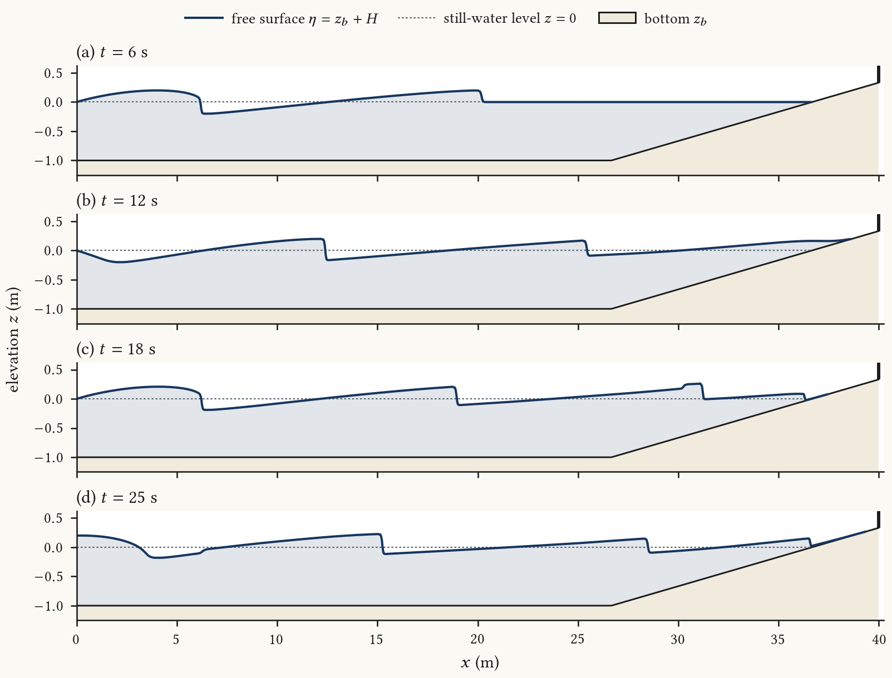

<!-- Author: Dr. Denys Dutykh (Mathematics Department, Khalifa University of Science and Technology, Abu Dhabi, UAE) -->

# 1DWaveTank: a numerical wave tank for the nonlinear shallow water equations, by finite volumes



The default experiment of the code (`sloping_beach`), computed in MATLAB as `run_simulation.m` computes it, at
t = 6, 12, 18 and 25 s. The tank is 40 m long and 1 m deep at rest, with a beach of slope 0.1 over its last third and a
wall at its right end; at the left end the depth is driven as 1 + 0.2 sin(2πt/4) m. The first two sine waves have
steepened into bores over the flat bottom (a); the first one has run up the beach to 0.2 m above the still-water level
(b); the second bore climbs the slope while the water of the first one runs back down (c); the run ends with three bores
in the tank (d). The computation uses 1000 cells, the MUSCL reconstruction with the van Albada limiter, HLLE fluxes and
the integrator `ode113` of MATLAB with tolerances 10⁻⁵; it takes about 26 s. The figure was made with version 1.2.0;
in runs of versions 1.2.0 and 1.3.0 in GNU Octave, the free surfaces differ by at most 5.3 mm at these four times, too
little to be seen at this scale (see Version 1.3.0: what changed).

The MATLAB code 1DWaveTank solves the nonlinear shallow water (Saint-Venant) equations in one space dimension by
finite volume methods, over a variable bottom that may emerge from the water, with walls, wave-making,
open or periodic ends, and an optional bottom friction. It is a laboratory to compare schemes: each ingredient
(numerical flux, reconstruction, slope limiter, time integrator, boundary condition, initial condition, bottom,
friction law) is a function in its own package folder, chosen by a function handle in the configuration. No article
accompanies the code, so the software itself is cited (see How to cite).

## The problem

With the total depth H(x, t), the discharge HU(x, t) (U is the velocity averaged over the depth), the bottom elevation
z_b(x) and the free surface η = z_b + H, all elevations being counted upwards from the still-water level, the code
solves

```text
∂H/∂t  + ∂(HU)/∂x               = 0,
∂(HU)/∂t + ∂(HU² + g H²/2)/∂x    = − g H ∂z_b/∂x + F,
```

where g = 9.81 m/s² and F is the bottom friction of the chosen law (none by default; Chézy, Manning and
Darcy–Weisbach laws are provided). A cell whose depth is below the dry tolerance 10⁻⁶ m counts as dry.


The sketch above shows a tank in the notation of long-wave models (free surface y = η(x, t), flat bottom y = −d,
velocity ū averaged over the depth); the code uses a bottom z_b(x) of any shape, the total depth H and the discharge HU.

The tank is cut into N cells of width Δx, and the averages of H and HU over the cells obey a system of ordinary
differential equations: the differences of the numerical fluxes across the cell interfaces, given by an approximate
Riemann solver from the states on both sides, and a discrete bed slope. Three right-hand sides are provided. The
first-order one, `core.rhs_nsw_1st_order`, uses the hydrostatic reconstruction of Audusse, Bouchut, Bristeau, Klein and
Perthame (2004, cited below): before the Riemann solver is called, the depths on both sides of the interface between
cells i and i + 1 are lowered to the higher of the two bottoms, and the bed slope enters the momentum equation of cell i
through these lowered depths (Φ is the momentum component of the numerical flux, z[i] the bottom of cell i):

```text
H_L[i+1/2] = max(0, H[i]   + z[i]   − max(z[i], z[i+1]))       (left state at the interface i + 1/2)
H_R[i+1/2] = max(0, H[i+1] + z[i+1] − max(z[i], z[i+1]))       (right state at the interface i + 1/2)

d(HU)[i]/dt = − (Φ[i+1/2] − Φ[i−1/2])/Δx + g/(2Δx) (H_L[i+1/2]² − H_R[i−1/2]²)
```

so that a lake at rest is an exact steady state over any bottom, at the ends of the tank as well (see below). The
hybrid and high-order ones, `core.rhs_nsw_hybrid_order` and `core.rhs_nsw_high_order` (that of the default experiment),
use the second-order extension of the same scheme (Section 3 of the same article, written once in
`core.hydrostatic_reconstruction_2nd_order`). The chosen reconstruction (MUSCL with a slope limiter, for instance) gives
the depth H and the free surface η = H + z at the two edges of every cell, H_left[i] and η_left[i] at its left edge,
H_right[i] and η_right[i] at its right edge, and the bottom at each edge is their difference, z_left[i] = η_left[i] −
H_left[i] and z_right[i] = η_right[i] − H_right[i]; the discharge HU gives the velocity at the edges. The interface
states and the bed slope are then

```text
z[i+1/2]   = max(z_right[i], z_left[i+1])
H_L[i+1/2] = max(0, η_right[i]  − z[i+1/2])
H_R[i+1/2] = max(0, η_left[i+1] − z[i+1/2])

d(HU)[i]/dt = − (Φ[i+1/2] − Φ[i−1/2])/Δx
              + g/(2Δx) (H_L[i+1/2]² − H_right[i]² + H_left[i]² − H_R[i−1/2]²)
              + g/(2Δx) (H_left[i] + H_right[i]) (z_left[i] − z_right[i])
```

The last term is the bed slope − g H ∂z/∂x of cell i, centred; the one before it is not zero only where the
reconstructed bottom jumps at an interface. At a lake at rest the free surface is flat at every edge of a wet cell, the
two states at each interface are equal, and the three terms cancel exactly: the scheme is well balanced, at a
shoreline too, and it is second-order accurate on smooth solutions (see A check of the schemes). The two right-hand
sides compute the same scheme; the hybrid one also accepts the friction coefficient `phys.Cf` of the earlier versions.
The system is then integrated in time either by a solver of MATLAB (`ode113`, `ode45`, ...) or by one of the explicit
schemes of the folder `+time`, whose step obeys the condition Δt = CFL Δx / max(|U| + √(gH)) or an estimate of the
local error.

At a solid wall, the ghost cells beyond the end of the tank hold the mirror image of the cells next to it: the depth
and the bottom are reflected as even functions about the wall, the discharge as an odd one. For a wall closing the tank
after its last cell N,

```text
H[N+k] = H[N+1−k],     HU[N+k] = − HU[N+1−k],     z[N+k] = z[N+1−k],     k = 1, 2, ...
```

Data reflected in this way stay symmetric under the shallow water equations, so that the velocity vanishes on the wall
(the argument of LeVeque, Finite Volume Methods for Hyperbolic Problems, Cambridge University Press 2002, Section 7.3.3,
with the bottom reflected like the depth). At the interface on the wall, the hydrostatic reconstruction then meets the
same bottom on both sides and the same depth H[N], so that no water crosses the wall and a lake at rest stays at rest
next to it, over any bottom. At an open end the ghost cells keep the bottom function beyond the end and receive the free
surface and the discharge of the end cell (function `bc.open`): for an open end after the cell N,

```text
z[N+k] = z_b(x[N+k]),     H[N+k] = max(0, H[N] + z[N] − z[N+k]),     HU[N+k] = HU[N],     k = 1, 2, ...
```

(and dry ghost cells after a dry end cell), which over a flat bottom is the copy of the end cell. The ghost cells of a
wave-making end all hold the prescribed depth; they take the bottom of the end cell, as if the tank went on beyond its
end over a flat bottom, so that their free surface oscillates about the still-water level when the prescribed depth
oscillates about the depth of the end cell. In a periodic tank the ghost cells hold the periodic image of the bottom,
as of the state. In every case the free surface η = H + z of a ghost cell is that of the water it stands for, and a
lake at rest stays at rest at the end of the tank; the three right-hand sides give their ghost cells these bottoms
(function `bc.ghost_bathymetry`, which calls `bc.wall_bathymetry` at a wall).

## Quick start

In MATLAB, from the root folder of the repository:

```matlab
run_simulation
```

The script adds the repository to the path, builds the configuration of the experiment selected in
`+cfg/simulation_config.m` (by default `sloping_beach`), prints it, solves the equations with `core.solver`, animates
the free surface, the bottom and the velocity at every output time, and prints the CPU time (about 26 s for the default
experiment with version 1.2.0, with MATLAB R2025b on one core; the reconstruction of the free surface in version 1.3.0
makes each evaluation of the right-hand side about 23 % longer in GNU Octave). The solution stays in the workspace:
`results.t` holds the output times and `results.H`, `results.HU` and `results.U` one row per output time and one column
per cell, and `config` holds the configuration. With `config.save_results = true` in the configuration, both are also
saved to a file `output/results_<date>_<time>.mat`.

Another experiment is chosen by editing the line

```matlab
experiment_setup = 'sloping_beach'; % CHANGE THIS TO SELECT SETUP
```

near the top of `+cfg/simulation_config.m`; the parameters of each experiment are set in its own `case` of that file.
The user guide `UserGuide.md` describes the configuration fields and every component that can be chosen.

## Experiments

The nine experiments are the cases of `+cfg/simulation_config.m`; each case completes the defaults of
`+cfg/default_config.m` and the common settings written at the top of the file, which select a tank of 20 m with 500
cells, the first-order scheme with PVM fluxes and `ode113` with tolerances 10⁻⁴, up to t = 10 s. All nine run to their
final time. The last column reports a run of each in GNU Octave 11.1 (with `ode45` at the same tolerances where an
experiment asks for `ode113`, and with a stand-in for the function `contains` of MATLAB, which the MUSCL reconstruction
calls with a limiter of two arguments; Octave has neither) and, for the closed tanks, the largest change of the volume of
water V(t) = Σ H[i] Δx during the run, relative to its initial value.

| Experiment | Set-up | Run |
|---|---|---|
| `sloping_beach` | the default experiment, shown above | to 25 s; the free surface differs from that of version 1.2.0 by at most 9.4 mm, at the front of the first run-up, against 6.5 cm between the solutions on 500 and 1000 cells; the waves run up to 0.331 m above the still-water level, and the depth never falls below 5.6 × 10⁻⁷ m |
| `flat_wave_gen` | sine waves of amplitude 0.1 m and period 2π s made at the left end of a 20 m tank of depth 0.5 m, wall at the right end; MUSCL with the van Leer limiter, PVM fluxes, the second-order strong-stability-preserving Runge–Kutta scheme (SSP2) at CFL = 0.95 | to 10 s; the depth differs from that of version 1.2.0 by at most 2.6 × 10⁻⁵ m, round-off differences over the flat bottom that the PVM flux, without dissipation below 10⁻⁶, lets grow |
| `flat_rest` | lake at rest 0.5 m deep over a flat bottom, walls at both ends; first order | to 10 s; the water stays at rest, the discharge exactly zero and the depth 0.5 m to 10⁻¹⁵; V constant to 2 × 10⁻¹⁶ |
| `gaussian_bump_rest` | lake at rest over a Gaussian bump of height 0.05 m, walls; hybrid scheme with MUSCL and the van Leer limiter, HLLC fluxes, `ode113` with tolerances 10⁻⁹ | to 10 s, but the tank holds no water: `ic.lake_at_rest` puts the free surface at z = 0, the level of the bottom on which the bump stands, so that every cell has the dry depth 10⁻⁶ m, which now stays exactly in place |
| `flat_gaussian` | hump 0.1 exp(−2 (x − 10)²) m of the free surface, at rest on a depth of 0.5 m, open ends; MUSCL with the van Leer limiter, PVM fluxes, SSP2 at CFL = 0.95 | to 10 s; the two halves of the hump leave through the open ends, and V falls from 10.125 to 9.996 m²; the same solution as with version 1.2.0, to the last bit |
| `flat_solitary` | solitary wave of amplitude 0.2 m on a depth of 0.5 m in the middle of the tank, walls; first order | to 10 s, the wave reaching the right wall at t = 3.3 s; V constant to 3 × 10⁻¹⁵ |
| `periodic_solitary` | the same wave in a periodic tank; first order | to 10 s; V constant to 2 × 10⁻¹⁵ |
| `dam_break` | breaking of a dam at x = 10 m between depths 0.8 m and 0.5 m, walls; first order, SSP2 at CFL = 0.95 | to 3 s; V constant to 4 × 10⁻¹⁵ |
| `dry_dam_break` | breaking of a dam at x = 10 m holding a depth of 0.5 m, dry bottom beyond it, walls; MUSCL with the van Leer limiter, asked in the Riemann invariants u ∓ 2√(gH) and done on the velocity (see Version 1.3.0: what changed), HLLE fluxes, forward Euler steps at CFL = 0.45 | to 1 s; V constant to 3 × 10⁻¹⁵, the depth never negative, the front (the last cell deeper than 1 mm) at x = 14.38 m where the exact solution of Ritter puts it at 10 + 2√(g × 0.5) = 14.43 m (14.10 m with version 1.2.0) |

The solitary wave is that of the Serre–Green–Naghdi equations (Carter and Cienfuegos, European Journal of Mechanics
B/Fluids 30, 2011, equation (9)); the shallow water equations, which have no dispersion, steepen it into a bore. Ritter's
solution of the dam break over a dry bottom is derived in Castro-Orgaz and Hager, Shallow Water Hydraulics, Springer
2019, Section 6.2: the front moves at the speed 2√(g h_L), h_L being the depth behind the dam.

Version 1.2.0 makes every experiment run. Four initial conditions, `ic.gaussian_bump`, `ic.solitary_wave`,
`ic.dam_break` and `ic.dry_dam_break`, took the cell centres as their first argument, while `core.solver` calls every
initial condition as `ic_handle(cfg)`; they now take `cfg` alone, as `ic.lake_at_rest` does, and read the cell centres
in `cfg.mesh.xc`. The experiments `flat_gaussian` and `periodic_solitary` read the field `config.param`, which the
common settings no longer define; they now set their still depth themselves (and `periodic_solitary` the amplitude of
its wave). The settings of `dry_dam_break` gave its MUSCL reconstruction neither a method nor an order, which
`cfg.validate_config` needs, and did not pass it to the high-order right-hand side, which would then have computed at
first order; both are set now, and its CFL number is 0.45 instead of 0.95, because forward Euler steps with a
second-order reconstruction keep the depth nonnegative under half the CFL bound of the first-order scheme (Audusse et
al. 2004, Section 3): at 0.95 the depth fell to −1.5 cm at the front. Four experiments, `flat_rest`, `flat_gaussian`,
`flat_solitary` and `periodic_solitary`, never set the ends of their mesh, which `cfg.validate_config` builds from
`mesh.domain`, and so were set in the 100 m tank of the defaults (where `flat_rest` ran) instead of the 20 m tank of
their names and initial conditions; they now copy the ends of the tank into `mesh.domain`. Finally, `flat_rest` sets its
flat bottom 0.5 m below the still-water level, so that its tank holds the 0.5 m of water of its name.

The solid wall of version 1.2.0 reflects the bottom as well (see The problem). The bottom of its ghost cells used to be
the bottom function evaluated beyond the wall, so that over a sloping bottom the two states of the hydrostatic
reconstruction at the wall differed in depth by about |dz/dx| Δx: a lake at rest was set in motion from the walls, and
water crossed them, at a rate that does not decrease with Δx. In a tank of 10 m closed by two walls over the bottom
z = −1 + 0.05 x, the first-order scheme gave the depth in the two cells next to the walls the time derivatives 0.078
and 0.055 m/s at rest, with 100, 200 or 400 cells alike; in 4000 steps of SSP2 at CFL = 0.5 (64 s, 100 cells), the
velocity reached 0.021 m/s and 2 % of the water left the tank. With the reflected bottom the velocity stays below
5 × 10⁻¹⁵ m/s and the volume does not change (A check of the schemes). Over a flat bottom the reflected and the former
ghost bottoms coincide, so that a wave reflected from a wall over a flat bottom is computed exactly as before, to the
last bit: `flat_wave_gen` is, and so is a hump of the free surface released between two walls over a flat bottom and
reflected back and forth for 20 s, by each of the three right-hand sides.

Version 1.1.1 corrected a misprint at line 84 of `+cfg/simulation_config.m`, where the common settings wrote the empty
reconstruction into the field `reconstructopenion` instead of `reconstruction`, the field that `cfg.validate_config`
reads. Through the misprint, the characteristic MUSCL reconstruction that `+cfg/default_config.m` defines as its default
reached every experiment that does not replace it whole: the configuration then announced a MUSCL reconstruction of
order 2 for experiments computed without one, and `gaussian_bump_rest` reconstructed in characteristic variables, which
its own settings do not ask for. The default experiment and `flat_wave_gen` gave the same solutions as before to the
last digit.

## Version 1.3.0: what changed

Version 1.3.0 makes the hybrid and high-order schemes well balanced, as the first-order one already was, by rebuilding
them on the free surface as Audusse et al. (2004, Section 3) do (see The problem). They used to reconstruct the depth H
and the discharge HU, and to lower the reconstructed depths with the bottoms of the cell centres (hybrid scheme) or to
put the mean of two bottoms on each interface (high-order scheme). Wherever the limiter flattens the reconstructed
depth, next to a wall over a slope s, at a kink of the bottom or at a shoreline, the two states at an interface then
differed by about s Δx/2 at rest, the depth changed at a rate near c s/4 with c = √(gH), whatever the cell width, and a
lake at rest was set in motion: in the tests of A check of the schemes its velocity reached 0.024 m/s over a slope,
0.069 m/s over a wavy bottom and 0.82 m/s at the shoreline of a beach.

Both schemes now reconstruct the depth and the free surface, take the bottom at the edges of each cell as their
difference, and apply the hydrostatic reconstruction and the bed slope of the article to these edge values. Of the three
quantities H, z and η = H + z, the article reconstructs H and η because this pair alone keeps both the lake at rest and
a nonnegative depth at a shoreline: a limited reconstruction of H is never negative, and a limited reconstruction of η is
flat in a wet cell at rest, even next to a dry one, where the free surface reconstructed in the dry cell lies at or above
that of the lake,

```text
η_left[i+1] = η[i+1] − φ(η[i+1] − η[i], η[i+2] − η[i+1])/2  ⩾  η[i]     when H[i+1] = 0 and η[i+1] > η[i],
```

since every limiter φ of `+reconstruct/+limiters` satisfies 0 ⩽ φ(a, b) ⩽ 2 min(a, b) when a and b are positive, and
φ(a, b) = 0 when a × b ⩽ 0. A reconstruction in the Riemann invariants u ∓ 2√(gH), which `dry_dam_break` asks for,
cannot serve here: in a lake at rest over a sloping bottom the invariants vary with the depth, their reconstruction is
not flat, and a depth taken from them does not match the reconstructed free surface. Where it is asked for, the
velocity U is reconstructed instead of the discharge, component by component like H and η; a limited velocity stays
between the velocities of the neighbouring cells at a wetting front, where the velocity HU/H of a reconstructed
discharge may grow without bound. A cell shallower than the dry tolerance has zero depth at its edges, so that the films
of 10⁻⁶ m that `ic.lake_at_rest` leaves on dry ground stay in place until water arrives. The two right-hand sides call
the same function, `core.hydrostatic_reconstruction_2nd_order`, and compute the same scheme.

The ghost cells of the high-order scheme at a wall now hold the mirror image of the bottom, as those of the two other
schemes have done since version 1.2.0. An open end used to copy the depth of the end cell into its ghost cells over the
bottom function beyond the end, and a wave-making end to put its prescribed depth over that bottom, so that over a
slope the free surface of the ghost cells differed from that of the tank and water flowed through the end from rest:
between two open ends over the slope z = −1 + 0.05 x, the depth of the end cells changed at rest at 0.078 m/s with the
first-order scheme and 0.039 m/s with the others, and every computation failed before t = 13 s; over the wavy bottom
87 % of the water left the tank in 74 s, and over the beach all of it. An open end now extends the free surface of
the end cell over the bottom function (see The problem), and a wave-making end puts its depth over the bottom of the
end cell (function `bc.ghost_bathymetry`, called by the three right-hand sides). Copying the bottom of the end cell
into the ghost cells of an open end would also keep the lake at rest, but over the wavy bottom it let round-off errors
grow into a current through the tank, by a factor e every 3 s from t = 80 s with the first-order scheme; with the
extended free surface the first-order scheme shows no such growth in 148 s (see A check of the schemes for the second
order). The first-order scheme is otherwise unchanged.

The experiments that use the first-order scheme (`flat_rest`, `flat_solitary`, `periodic_solitary`, `dam_break`) and
`flat_gaussian`, whose open ends stand on a flat bottom, give the same solutions as with version 1.2.0, to the last bit.
In the default experiment, version 1.2.0 already disturbed the lake at rest at the foot of the beach, where its free
surface fell by 0.83 mm within 0.2 s and stayed there, long before the first wave arrived; version 1.3.0 keeps the lake
ahead of the waves flat to 4 × 10⁻¹⁶ m. Over the whole run, computed in GNU Octave with `ode45` at the tolerances of the
experiment, the free surfaces of the two versions differ by at most 9.4 mm, at the front of the first run-up at
t = 12.6 s, and by 1.4 to 5.3 mm at t = 6, 12, 18 and 25 s, the mean difference of the depths staying below 0.2 mm;
the solutions of version 1.3.0 on 500 and 1000 cells differ by 2.7 to 6.5 cm, so that the change lies well within the
error of the scheme. The bores, the run-up to 0.331 m above the still-water level at t = 12.6 s and the volume of water,
33.0146 against 33.0142 m² at t = 25 s, are those of version 1.2.0. In `flat_wave_gen`, over a flat bottom, the depths
differ by at most 2.6 × 10⁻⁵ m, round-off differences that the PVM flux lets grow; `dry_dam_break` now puts the front of
the water at t = 1 s at x = 14.38 m, where the exact solution of Ritter puts it at 14.43 m (14.10 m with version 1.2.0);
and the films of `gaussian_bump_rest` stay in place exactly. The second reconstruction makes an evaluation of the
right-hand side of the default experiment about 23 % longer in GNU Octave.

## A check of the schemes

A scheme is well balanced when a lake at rest (U = 0, and η = 0 wherever the bottom lies below the still-water level) is
an exact steady state of its discrete equations. Three bottoms were tried on 0 ⩽ x ⩽ 10 m, cut into 100 cells: the
slope z = −1 + 0.05 x, the wavy bottom z = −0.7 + 0.15 sin(2πx/7) + 0.02 x, and the beach z = −1 + 0.15 x, whose
shoreline lies 3.3 m before the right end; the tank was closed by walls at both ends, or open at both ends. The state
H = max(−z, 0), HU = 0 was advanced by 4000 steps of SSP2 at CFL = 0.5 (64 to 74 s), with HLLE fluxes and, for the
second-order schemes, the MUSCL reconstruction with the van Albada limiter of the default experiment. The table gives the
largest velocity in the wet cells during the run, in m/s, with versions 1.2.0 and 1.3.0 of the code.

| Bottom and ends | First order, 1.2.0 | First order, 1.3.0 | Hybrid and high order, 1.2.0 | Second order, 1.3.0 |
|---|---|---|---|---|
| slope, walls | 4.3 × 10⁻¹⁵ | 4.3 × 10⁻¹⁵ | 0.024 and 0.011 | 2.6 × 10⁻¹⁵ |
| wavy bottom, walls | 4.8 × 10⁻¹⁵ | 4.8 × 10⁻¹⁵ | 0.069 and 0.029 | 3.2 × 10⁻¹⁵ |
| beach, walls | 4.5 × 10⁻¹⁵ | 4.5 × 10⁻¹⁵ | 0.57 and 0.82 | 2.4 × 10⁻¹⁵ |
| slope, open ends | computation failed at t = 12.7 s | 1.3 × 10⁻¹⁴ | computation failed at t = 12.9 and 12.8 s | 1.2 × 10⁻¹⁴ |
| wavy bottom, open ends | 2.6, and 87 % of the water lost | 1.1 × 10⁻¹⁴ | 2.6 and 2.7, and 87 % of the water lost | 4.7 × 10⁻¹⁵ |
| beach, open ends | 3.4, and all the water lost | 8.4 × 10⁻¹⁵ | 3.4 and 4.9, and all the water lost | 9.1 × 10⁻¹⁵ |

With version 1.3.0 the time derivative of the depth is exactly zero at rest, that of the discharge below 1.3 × 10⁻¹⁴
m²/s², the free surface stays within 1.3 × 10⁻¹⁵ m of rest and the volume constant to 2.5 × 10⁻¹⁵, in every case and for
the three schemes. The second-order schemes keep the lake at rest just as well with the minmod limiter, and with the van
Leer limiter when the velocity is reconstructed in place of the Riemann invariants (largest velocity 4.1 × 10⁻¹⁴ m/s),
and with the fluxes HLL, HLLC, Rusanov, Roe, FVCF, Lax–Friedrichs and central-upwind (below 2.4 × 10⁻¹⁴ m/s over the
wavy bottom and the beach between walls). The other reconstructions of `+reconstruct` keep the beach between walls at
rest over 200 steps, to 2.5 × 10⁻¹⁵ m/s with ENO2, UNO2, PPM, MP5 and MUSCL with the limiters UMIST, superbee and MC,
and to 8 × 10⁻¹³ m/s with WENO5, whose reconstruction of a constant is exact only to round-off. With version 1.2.0 the
depth of the second-order schemes changed at rest at rates up to 0.039, 0.10 and 0.12 m/s over the three bottoms, and
the depth at an open end over a slope at 0.078 m/s with the first-order scheme. Over the bottom of the default
experiment, whose beach meets the flat bottom at a kink, the right-hand side of version 1.2.0 at rest reached 0.060 m/s
in the depth and 0.22 m²/s² in the discharge; that of version 1.3.0 gives 0 and 3 × 10⁻¹⁴ m²/s².

Two drifts remain, both of the order of a tolerance. With PVM fluxes the velocity of the lake at rest reaches 10⁻⁶ m/s,
and 1.5 × 10⁻⁵ m/s at the shoreline of the beach with the second-order schemes: the PVM flux adds no dissipation where
the states on the two sides of an interface differ by less than 10⁻⁶ in depth and in discharge (its threshold is the dry
tolerance), so that rounding errors grow up to that size. Between two open ends over the slope or the wavy bottom, with
the van Leer limiter, round-off errors grow slowly over long times, by a factor e in about one minute, to
4 × 10⁻¹⁴ m/s after 128 s over the slope and 8 × 10⁻¹⁴ m/s after 148 s over the wavy bottom; the same lakes between
walls, or between a wave-making end at rest and a wall, or computed with the van Albada limiter or the first-order
scheme, show no such growth in 148 s.

The order of accuracy was measured on a smooth flow: a periodic tank 0 ⩽ x ⩽ 10 m over the bottom
z = −1 + 0.3 sin(2πx/5), with the initial free surface η = 0.05 exp(−2 (x − 5)²) m and the uniform discharge
HU = 0.2 m²/s, computed to t = 1 s, before any wave breaks, with HLLE fluxes, the MUSCL reconstruction with the van Leer
limiter and the third-order strong-stability-preserving Runge–Kutta scheme at CFL = 0.4. The table gives the L1 error of
the depth, the mean of |H − H_ref| over the tank, against a reference computed by the same scheme on 3200 cells and
averaged over the coarse cells, with the observed order log₂(e(N/2)/e(N)) in parentheses.

| N | Second order, 1.3.0 | High order, 1.2.0 | Hybrid, 1.2.0 | First order |
|---|---|---|---|---|
| 50 | 1.0 × 10⁻³ | 4.3 × 10⁻³ | 1.7 × 10⁻² | 4.7 × 10⁻³ |
| 100 | 3.1 × 10⁻⁴ (1.70) | 1.1 × 10⁻³ (1.95) | 8.2 × 10⁻³ (1.07) | 2.9 × 10⁻³ (0.70) |
| 200 | 8.7 × 10⁻⁵ (1.83) | 2.9 × 10⁻⁴ (1.94) | 3.9 × 10⁻³ (1.09) | 1.6 × 10⁻³ (0.82) |
| 400 | 2.2 × 10⁻⁵ (1.98) | 7.4 × 10⁻⁵ (2.00) | 1.8 × 10⁻³ (1.12) | 8.4 × 10⁻⁴ (0.95) |
| 800 | 5.1 × 10⁻⁶ (2.10) | 1.7 × 10⁻⁵ (2.08) | 7.5 × 10⁻⁴ (1.23) | 3.8 × 10⁻⁴ (1.14) |

The second-order scheme of version 1.3.0 converges at the order 2 (the differences between successive meshes give 1.97
between 400 and 800 cells), with errors three times smaller than those of the high-order scheme of version 1.2.0,
which was of order 2 on this flow too, its imbalance showing only where the limiter flattens the depth; the hybrid scheme
of version 1.2.0 was of order 1, like the first-order scheme. The largest error converges at the order 1.7, the limiter
lowering the order near the extrema of the solution. The two right-hand sides of version 1.3.0 give the same solution,
to the last bit.

The depth stays nonnegative at a moving shoreline. The default experiment was computed with the right-hand side of
version 1.3.0 and SSP2 steps at CFL = 0.45, half the CFL bound of the first-order scheme, under which Audusse et al.
(2004, Theorem 3.1) prove that the second-order scheme keeps the depth nonnegative: over its 5565 steps, the smallest
depth after any stage is 7.4 × 10⁻⁷ m, in the films of 10⁻⁶ m left on the dry beach by the initial condition, and the
waves run up the beach to 0.331 m above the still-water level, as with version 1.2.0. Computed with `ode45` at the
tolerances 10⁻⁵ of the experiment, which does not guarantee positivity, the smallest depth in the 126 stored frames is
5.6 × 10⁻⁷ m.

## Contents

| Folder or file | Contents |
|---|---|
| `run_simulation.m` | the main script: configuration, solution, animation and statistics |
| `+cfg/` | `default_config.m` (defaults), `simulation_config.m` (the experiments), `validate_config.m` (checks and completes the configuration) |
| `+core/` | `solver.m` (initial condition, time integration, output), the right-hand sides `rhs_nsw_1st_order.m`, `rhs_nsw_hybrid_order.m` and `rhs_nsw_high_order.m`, and `hydrostatic_reconstruction_2nd_order.m`, the interface states and the bed slope of the second-order scheme; the folder `multilayer/` holds a separate solver of the multilayer shallow water equations for atmospheric flows (layers of air with the densities of the standard atmosphere), with its own copies of these components |
| `+flux/` | sixteen numerical fluxes: AUSM+ (`AUSM.m`), AUSMDV, central-upwind (`CentralUpwind.m`), FORCE, FVCF, HLL, HLLC, HLLE, kinetic (`Kinetic.m`), Lax–Friedrichs (`LF.m`), Osher–Solomon, PVM, Roe, Rusanov, SLAU and Steger–Warming |
| `+reconstruct/` | reconstructions of the interface values: none (first order), MUSCL, ENO2, UNO2, PPM, WENO5, MP5 and THINC, named in `reconstruct_selector.m`; the folder `+limiters/` holds the slope limiters of MUSCL: minmod, van Leer, van Albada, superbee, MC, Koren, UMIST, OSPRE and Sweby |
| `+time/` | explicit integrators with a step set by the CFL condition (forward Euler, the strong-stability-preserving Runge–Kutta schemes SSP2 and SSP3, the classical fourth-order Runge–Kutta scheme, the two-step Adams–Bashforth scheme) or by an estimate of the local error (Bogacki–Shampine 3(2), Dormand–Prince 5(4)), and `integrate_matlab_ode.m` for the solvers of MATLAB |
| `+bc/` | boundary conditions: `wall`, `open` (zero gradient), `periodic`, and `generating` (a depth prescribed in time, with the outgoing Riemann invariant taken from the tank); `ghost_bathymetry` gives the ghost cells the bottom that matches their state, through `wall_bathymetry` (the mirror image of the bottom) at a wall |
| `+ic/` | initial conditions, each called as `ic(cfg)`: `lake_at_rest`, `gaussian_bump`, `solitary_wave`, `dam_break` and `dry_dam_break` |
| `+bathy/` | bottoms: `flat`, `gaussian_bump` and `sloping_beach` |
| `+friction/` | friction laws: none, Chézy, Manning, and Darcy–Weisbach with a constant factor or the Colebrook–White factor, named in `friction_selector.m` |
| `+utils/` | the CFL time step, the physical flux, Roe averages, eigenvectors, a uniform mesh and a text progress bar |
| `+vis/` | `plot_state.m`, one frame of the animation |
| `docs/figures/` | the two scripts of the figure at the top of this page |
| `img/` | the sketch of the tank |

The figure is made by `docs/figures/wavetank_readme_data.m` (MATLAB, or GNU Octave), which solves the default
experiment as `run_simulation.m` does and writes every output frame to `wavetank_frames.mat`, and by
`docs/figures/plot_readme_figure.py` (Python 3 with NumPy, SciPy and Matplotlib, and the style file beside it), which
draws it. Both are run from `docs/figures/`, in this order.

## Requirements

MATLAB, with no toolbox (checked with R2025b). GNU Octave cannot run the default experiment as it stands, since it has
no `ode113`; the MUSCL reconstruction with a limiter of two arguments also calls `contains`, which Octave lacks. The
script `docs/figures/wavetank_readme_data.m` runs in both: without `ode113` it integrates with `ode45` at the same
tolerances, about thirty times more slowly in GNU Octave 11.1, whose depths over the first 4 s agree with those of
MATLAB to 2 × 10⁻⁵ m.

## How to cite

No article accompanies this code, so please cite the software itself:

D. Dutykh, 1DWaveTank: a numerical wave tank for the nonlinear shallow water equations, by finite volumes, version
1.3.0 (2026).

https://github.com/dutykh/1DWaveTank

```bibtex
@software{Dutykh_1DWaveTank,
  author = {Dutykh, Denys},
  title = {{1DWaveTank}: a numerical wave tank for the nonlinear shallow water equations, by finite volumes},
  year = {2026},
  version = {1.3.0},
  url = {https://github.com/dutykh/1DWaveTank},
  license = {GPL-3.0-or-later}
}
```

The button "Cite this repository" in the right-hand column of this page gives the same reference, read from
`CITATION.cff`. The hydrostatic reconstruction of the three schemes, and its second-order extension in the hybrid and
high-order ones, are those of the article

E. Audusse, F. Bouchut, M.-O. Bristeau, R. Klein and B. Perthame, A fast and stable well-balanced scheme with
hydrostatic reconstruction for shallow water flows, SIAM Journal on Scientific Computing 25, 2050–2065 (2004).

https://doi.org/10.1137/s1064827503431090

## Licence

GNU General Public License, version 3 or (at your option) any later version (see `LICENSE`). The functions `atmos.m` and
`pressurealt.m` of `+core/multilayer/` are by Sky Sartorius (MATLAB Central File Exchange, 2015), and the text progress
bar of `+utils/textprogressbar.m` is adapted from the one of Paul Proteus; they remain the work of their authors and are
not covered by the licence of this repository.

## Authors

Denys Dutykh (Mathematics Department, Khalifa University of Science and Technology, Abu Dhabi, UAE).

https://www.denys-dutykh.com/

Mehmet Ersoy (SEATECH and Institut de Mathématiques de Toulon, Université de Toulon) contributed the kinetic flux
`+flux/Kinetic.m`, written from his original Fortran code, and Francesco Carbone (Institute of Atmospheric Pollution
Research of the National Research Council of Italy, Rende) contributed the multilayer solver of `+core/multilayer/` and
pointed out several errors in the code. Questions, corrections and contributions are welcome through the issues and
pull requests of this repository.
